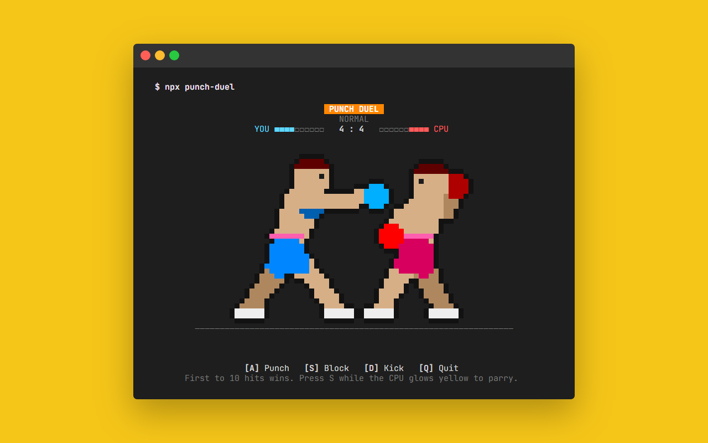

# Punch Duel

Boxing game you play right in your terminal. Step into the ring against the CPU, throw punches and kicks, block, and time a perfect parry to turn the fight around.




```bash
npx punch-duel
```

## Install

To keep it around, install it globally:

```bash
npm install -g punch-duel
punch-duel
```

Requires Node.js 18 or newer.

## Keys

| Key | |
| --- | --- |
| `N` | Start on Normal |
| `H` | Start on Hard |
| `A` | Punch |
| `S` | Block |
| `D` | Kick |
| `R` | Rematch |
| `Q` | Quit |

## Rules

- Punches are fast, but a block stops them.
- Kicks are slow, but they go through a block.
- A punch that lands while the other fighter winds up a kick cancels the kick.
- Right before the CPU hits, it flashes yellow. Block during the flash to parry: the attack misses, the CPU is stunned and you get a free hit. Block too early and it is only a normal block.
- Pick a difficulty when the game starts. On Hard the CPU is faster, reacts sooner, punishes kick spam and the parry flash is shorter. After a match, press R to replay the same difficulty or N/H to switch.

## License

MIT
